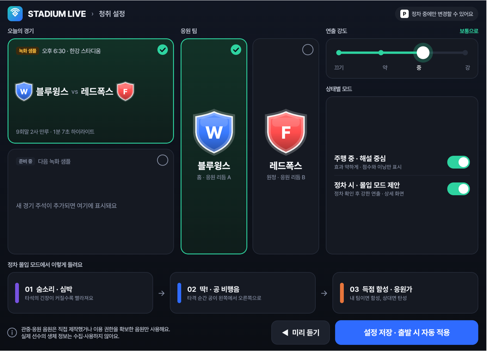
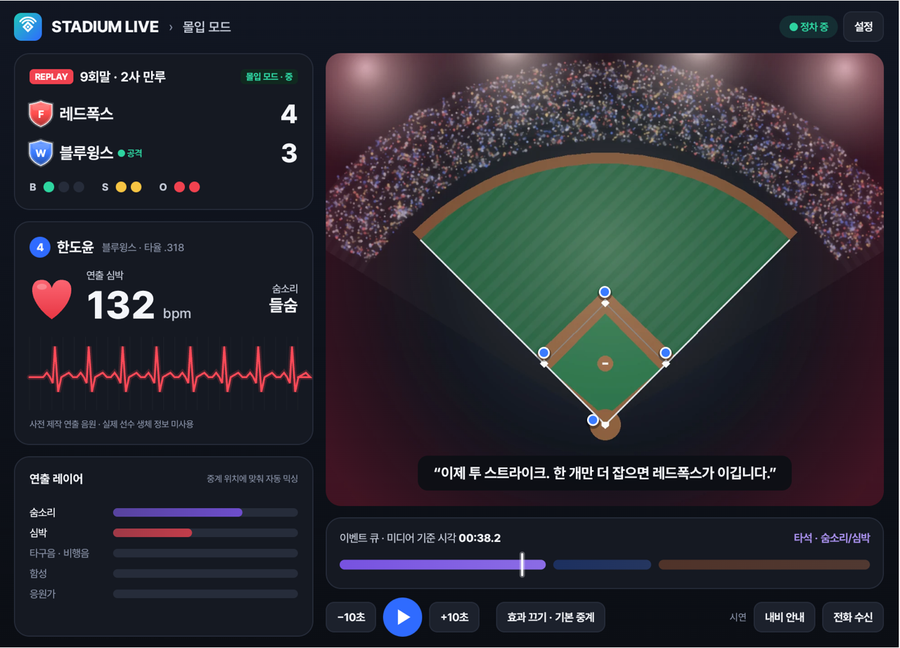
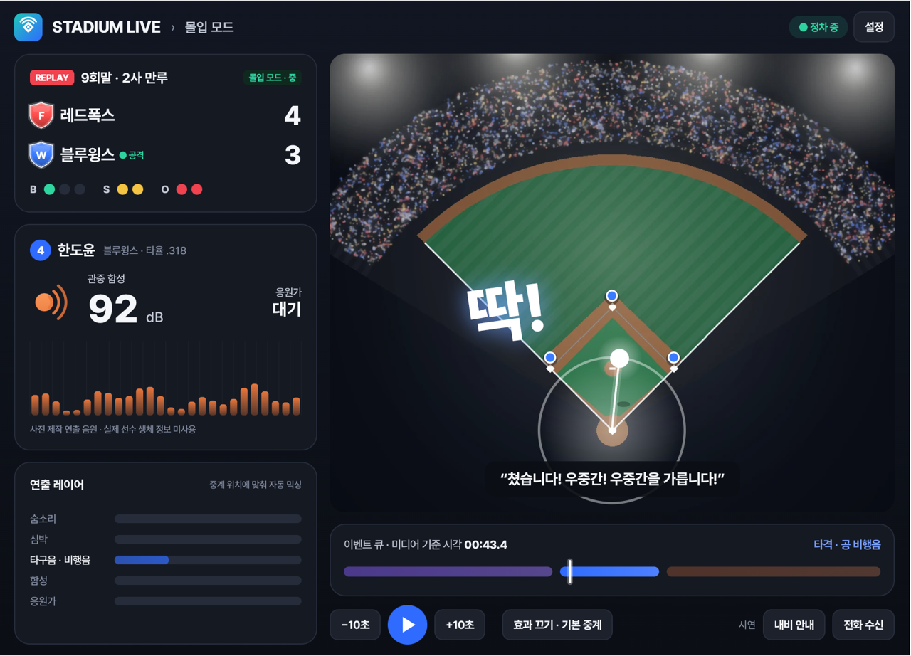
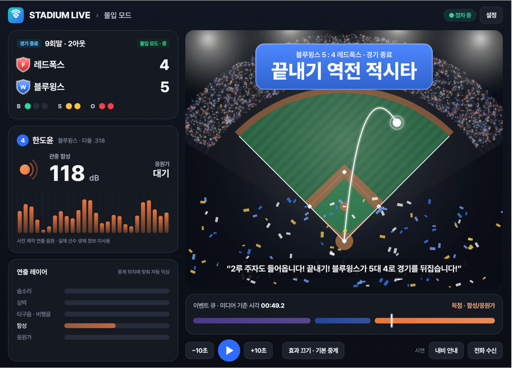
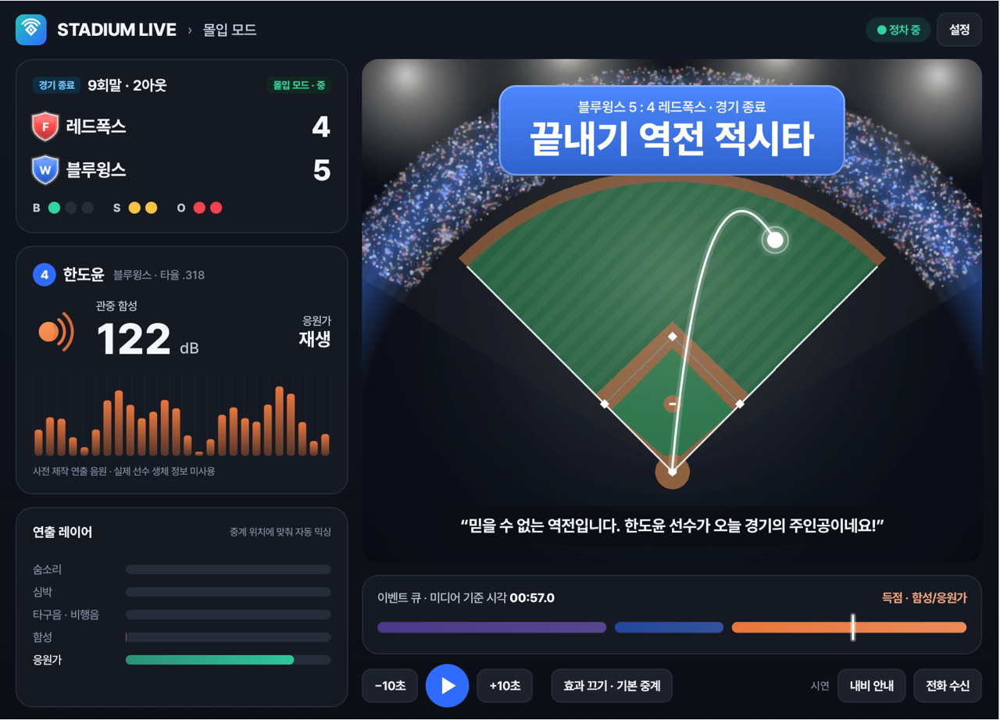
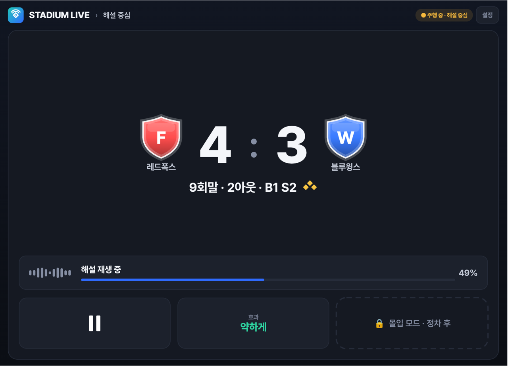

# STADIUM LIVE

Pleos Connect(Android Automotive) 차량에서 야구 중계를 들을 때, 경기 이벤트에 맞춰 숨소리·심박·타구음·함성·응원가를 얹어 주는 청취 앱입니다. 주행 중에는 해설 중심으로, 정차하면 몰입 연출로 자동 전환합니다.

| 출발 전 설정 | 정차 · 긴장 고조 | 타격 순간 |
|---|---|---|
|  |  |  |
| **끝내기** | **응원가** | **주행 중(해설 중심)** |
|  |  |  |

## 구현된 것

- **한 시계 동기화**: 중계 음원(Media3 ExoPlayer)의 재생 위치만 기준으로 25ms마다 효과를 결정합니다(`CueEngine`). 상태가 없는 계산이라 일시정지·탐색·되감기 뒤에도 같은 위치에서 같은 결과가 나옵니다. 사용자가 탐색한 점프는 효과를 건너뛰고, 오디오 장치 지연 보정 같은 의도치 않은 점프는 순간 효과만 따라잡습니다.
- **연출**: 타석 긴장도에 따라 빨라지는 심박(96→132bpm)·숨소리, 타격음과 좌→우로 이동하는 비행음, 내 팀 득점 함성/상대 득점 탄성, 끝내기 뒤 팀별 응원 리듬. 강도 약·중·강, 효과 끄기(기본 중계)로 바로 비교할 수 있습니다.
- **주행·정차**: AAOS `CarUxRestrictions`로 판단합니다. 제한 정보를 못 받으면 주행과 같이 제한합니다. 주행 중엔 숨소리·심박·비행음을 끄고 함성을 줄이며, 화면은 점수와 재생 버튼만 남깁니다. Pleos 주행 규제 가이드에 따라 `distractionOptimized`를 선언하고 제한은 앱이 직접 적용합니다.
- **오디오 포커스**: 전화(일시 포커스)는 중계와 효과를 함께 멈췄다가 복귀하고, 내비 안내는 멈추지 않고 함께 감쇠합니다. 화면의 "내비 안내 / 전화 수신" 시연 버튼은 실제로 다른 용도의 포커스를 요청해 이 동작을 재현합니다.
- **화면**: 시연 영상의 디자인(Pretendard, 단색 다크 카드, 민트 선택·파랑 주버튼, 글자 방패 엠블럼, 3구간 이벤트 큐)을 그대로 따랐습니다. 경기장은 `tools/make_stadium.py`로 미리 그린 이미지(흐린 관중 불빛·잔디 결·조명탑) 위에 주자, 타구 궤적·그림자, 충격파, '딱!', 득점 섬광·꽃가루, 끝내기 배너, 응원가 불빛 파도, 심박 비네트를 Compose로 얹습니다. 움직임은 모두 중계 시각에서 계산하므로 탐색해도 어긋나지 않습니다. '연출 레이어' 카드는 동기화 엔진이 지금 내는 소리를 그대로 보여 줍니다.
- **평가**: 경기가 끝나면 정차 상태에서 몰입감·해설 명료도·음량 변화 편의를 별점으로 저장합니다.

## 실행

JDK 17, Android SDK 34, Pleos Connect Emulator 2.1.0(AVD) 기준입니다.

```sh
./gradlew assembleDebug testDebugUnitTest
adb install -r app/build/outputs/apk/debug/app-debug.apk
```

특정 시점부터 보기(시연 촬영용): `adb shell am start -S -n kr.stadiumlive.vehicle/kr.stadiumlive.MainActivity --el startAt 43000 [--ez pause true]`

주행 상태 전환은 Pleos Virtual Console(`adb forward tcp:8088 tcp:8088` 후 http://localhost:8088)의 Gear D/P로 확인했습니다.

## 시연 영상

`demo/STADIUM_LIVE_실동작_시연.mp4`(1분 47초, 1080p)는 에뮬레이터 화면과 소리를 그대로 녹화한 실동작 영상입니다. 설정 → 주행(내비 감쇠·전화 일시정지) → 정차 몰입(긴장·타격·끝내기·응원가) → 평가 순서입니다.

```sh
adb forward tcp:8088 tcp:8088   # Virtual Console 탭을 브라우저에 열어 둔 상태여야 기어 변경이 먹힌다
tools/record_demo.sh demo/raw.webm          # 에뮬레이터 자체 녹화기(화면+소리), 기어는 Virtual Console HTTP API
tools/.venv/bin/python -I tools/edit_demo.py  # 구간 제목·기능 설명 칩, 음량 정규화(-16 LUFS)
```

## 음원 다시 만들기

모든 음원은 `tools/make_audio.py`가 만듭니다. 효과음은 numpy로 직접 합성하고, 해설은 macOS `say`(유나)로 읽어 중계 톤으로 다듬습니다. 이벤트 시각(`game1/game.json`)은 해설 문장의 실제 길이에서 계산하므로 음원과 항상 맞습니다.

```sh
python3 -m venv tools/.venv && tools/.venv/bin/pip install numpy
tools/.venv/bin/python -I tools/make_audio.py
```

경기장 이미지: `tools/.venv/bin/pip install pillow && tools/.venv/bin/python -I tools/make_stadium.py`

## 사용한 외부 자원

- 글꼴 [Pretendard](https://github.com/orioncactus/pretendard) v1.3.9 (SIL Open Font License 1.1, `app/src/main/assets/PRETENDARD_LICENSE.txt`)
- 그 밖의 음원·이미지·엠블럼은 모두 이 저장소의 스크립트와 코드로 직접 만들었습니다.

## 알아둘 점

- 경기·구단·선수(블루윙스, 레드폭스, 한도윤)는 모두 가상입니다. 심박은 실제 생체 정보가 아닌 연출값입니다.
- 해설 음성은 macOS 시스템 음성으로 만든 시연용입니다. 상용 배포 전에는 이용 조건이 분명한 TTS나 성우 녹음으로 바꿔야 합니다.
- 에뮬레이터의 오디오 장치가 가끔 시각을 보정하며 재생 위치가 몇 초씩 건너뜁니다. 앱은 이를 위의 따라잡기 규칙으로 처리하지만, 이벤트 오차(±0.5초 목표) 측정은 실차 또는 실기기에서 다시 해야 합니다.
- 라이브 경기 자동 인식, 개별 스피커·멀티채널 출력은 범위 밖입니다.
